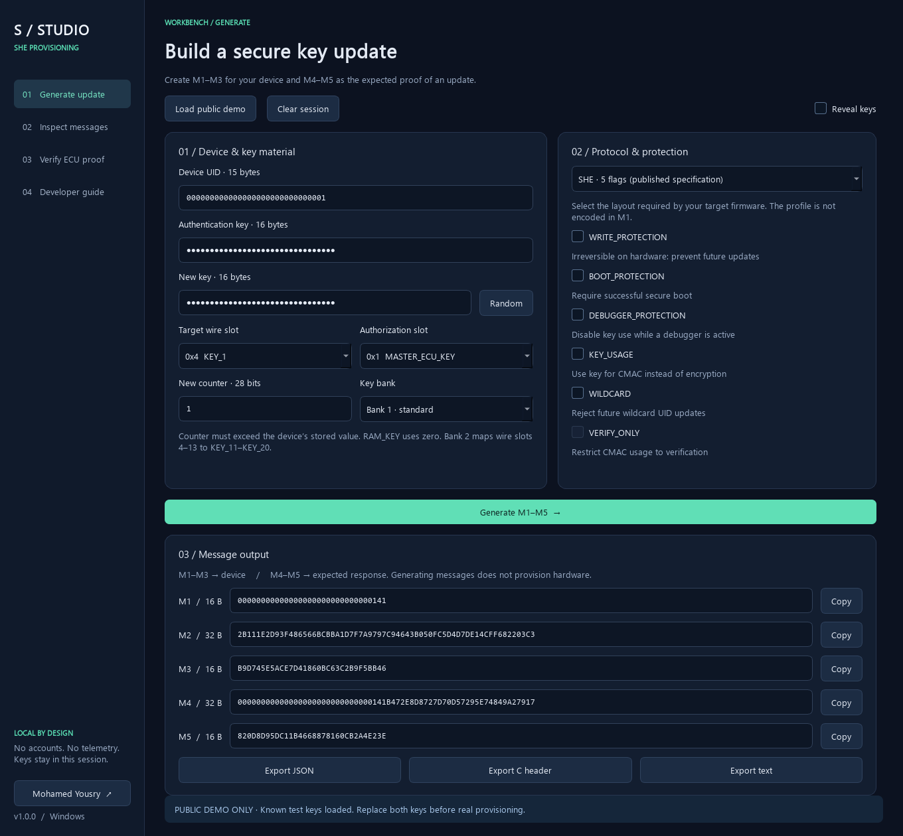

<div align="center">

# SHE Key Studio

**From key material to verified SHE update messages.**

An offline Windows workbench for embedded and automotive developers.

[Download Windows EXE](downloads/SHE-Key-Studio.exe?raw=true) · [User guide](docs/USER_GUIDE.md) · [Protocol](docs/PROTOCOL.md) · [CLI](docs/CLI.md) · [Portfolio](https://mohamedyousry01.github.io/Mohamed-Yousry-Portfolio/)


</div>



## What it does

- Generates **M1, M2, M3, M4, M5** for SHE key updates.
- Creates fresh AES-128 keys using the operating system's cryptographic random generator.
- Authenticates M3 before decrypting and inspecting an existing update.
- Verifies the ECU's received M4/M5 against the exact generated request.
- Supports explicit **five-flag** and **six-flag VERIFY_ONLY** layouts, plus selectable key-bank constants.
- Exports ready-to-include C headers, JSON bundles, and readable text without plaintext keys.
- Includes a standalone CLI for repeatable developer workflows.
- Runs locally without accounts, network calls, telemetry, or automatic key storage.

## Download and run

Windows 10/11, **64-bit**. Python is not required for the executables.

1. Download [SHE-Key-Studio.exe](downloads/SHE-Key-Studio.exe?raw=true), then double-click it.
2. Choose **Load public demo** to explore a complete known example.
3. Replace the demo UID and keys with your own device parameters, select the profile, and generate.
4. Export M1–M3 for your firmware and compare the actual device response in **Verify ECU proof**.

For scripting, download [she-key.exe](downloads/she-key.exe?raw=true).
Check [SHA256SUMS.txt](downloads/SHA256SUMS.txt) with PowerShell:

```powershell
Get-FileHash .\SHE-Key-Studio.exe -Algorithm SHA256
```

The executables are unsigned. A one-file executable extracts its runtime into
a temporary directory and may take a few seconds on first start.
The portable ZIP published through GitHub Releases also contains guides,
examples, and dependency notices. See [publishing](docs/PUBLISHING.md).

## A quick example

```powershell
.\downloads\she-key.exe generate .\examples\demo-input.json --output demo-output.json
```

The public demo produces:

```text
M1  00000000000000000000000000000141
M2  2B111E2D93F486566BCBBA1D7F7A9797C94643B050FC5D4D7DE14CFF682203C3
M3  B9D745E5ACE7D41860BC63C2B9F5BB46
M4  00000000000000000000000000000141B472E8D8727D70D57295E74849A27917
M5  820D8D95DC11B4668878160CB2A4E23E
```

**M4/M5 generated here are expected proof.** Only the messages actually returned
by your device can provide evidence that it accepted an update. This application
does not connect to hardware or manage an ECU's stored counter.

## Build from source

```powershell
py -3.14 -m venv .venv
.\.venv\Scripts\python.exe -m pip install -r requirements-dev.txt
.\.venv\Scripts\python.exe launch.py
.\.venv\Scripts\python.exe -m pytest -q
.\.venv\Scripts\python.exe scripts\build.py
```

Build output: `downloads/SHE-Key-Studio.exe`, `downloads/she-key.exe`, checksums,
and `release/SHE-Key-Studio-1.0.0-Windows-x64.zip`.
See [architecture and development](docs/DEVELOPMENT.md).

## Compatibility and limits

The default `she5` profile follows the five transmitted flags in the published
[AUTOSAR SHE R22-11 report](https://www.autosar.org/fileadmin/standards/R22-11/FO/AUTOSAR_TR_SecureHardwareExtensions.pdf).
`extended6` adds VERIFY_ONLY after WILDCARD. Bank 2 uses device extension constants.
**Select extensions only when your target firmware documents them.**
Profiles are explicit because a message does not identify its flag layout or bank.
The [protocol reference](docs/PROTOCOL.md) documents exact packing, IDs, and limits.

The tests cover known message bytes, both profiles, every flag combination,
counter boundaries, both banks, authenticated round trips, message tampering,
proof failures, exports, desktop flows, and CLI workflows. No physical ECU has
been used for acceptance testing. See [validation](docs/VALIDATION.md).

## Documentation

| Guide | Covers |
|---|---|
| [User guide](docs/USER_GUIDE.md) | Fields, flags, provisioning workflow, inspection, troubleshooting |
| [Protocol](docs/PROTOCOL.md) | KDF, byte layout, slots, profiles, banks, proof verification |
| [CLI](docs/CLI.md) | JSON schemas, commands, integration, exit codes |
| [Development](docs/DEVELOPMENT.md) | Source layout, tests, builds, dependency updates |
| [Publishing](docs/PUBLISHING.md) | Push to GitHub, direct EXE access, automatic releases |
| [Security](SECURITY.md) | Key handling, scope, reporting issues |

## Author

Built by **Mohamed Yousry**. Explore my [portfolio](https://mohamedyousry01.github.io/Mohamed-Yousry-Portfolio/).

Application source: [MIT](LICENSE). Bundled libraries: [third-party notices](THIRD_PARTY_NOTICES.md).
